# Laporan Praktikum PBO — Pert 7: Relasi Objek (Komposisi & Agregasi)

**Nama:** Adelita Daeli  
**NPM:** 4525210049  
**Kelas:** Praktikum PBO A  

---

## 1. Ringkasan Implementasi Kode Program

Pada pertemuan ini, praktikum berfokus pada penerapan dua jenis relasi utama antar objek dalam Object-Oriented Programming (OOP), yaitu **Komposisi (Composition)** dan **Agregasi (Aggregation)**, baik dalam bahasa pemrograman **Java** maupun **PHP**.

### A. Komposisi (`Buku` dan `Bab`)
* **Siklus Hidup Terikat:** Objek `Bab` merupakan bagian mutlak dari `Buku`. `Bab` tidak dapat diciptakan secara mandiri di luar kelas `Buku`[cite: 7].
* **Implementasi Konstruktor:** Kelas `Bab` memiliki konstruktor privat/terbatas, di mana instansiasi objek `Bab` (`new Bab(...)`) dilakukan langsung di dalam method `tambahBab()` pada kelas `Buku`[cite: 7, 8].
* **Imutabilitas Koleksi:** Method `getBab()` menggunakan `List.copyOf(bab)` untuk mengembalikan salinan koleksi yang tidak dapat diubah (*unmodifiable copy*). Jika pihak luar mencoba memodifikasi atau menghapus bab secara langsung (misalnya melalui `.clear()`), program akan menolak dengan memunculkan `UnsupportedOperationException`[cite: 7, 11].

### B. Agregasi (`Jurusan` dan `Mahasiswa`)
* **Siklus Hidup Mandiri:** Objek `Mahasiswa` diciptakan secara terpisah di luar kelas `Jurusan`[cite: 9, 10]. 
* **Pemberian Objek dari Luar:** Objek `Mahasiswa` diteruskan ke dalam `Jurusan` melalui method `daftarkan(Mahasiswa n)`[cite: 9].
* **Pelepasan Objek:** Apabila mahasiswa dikeluarkan dari jurusan melalui method `keluarkan(Mahasiswa n)`, objek `Mahasiswa` tersebut tetap hidup dan eksis di luar lingkup jurusan[cite: 9, 11].

### C. Lapisan Layanan (`PerpustakaanService`)
* Mengelola daftar koleksi buku (`daftarKoleksi`) menggunakan struktur data `ArrayList`[cite: 13].
* Menyediakan fitur bisnis dasar seperti `tambahKoleksi()`, `cariKoleksi()`, proses peminjaman (`pinjam()`) yang dilengkapi pengecekan ketersediaan stok, serta pengembalian buku (`kembalikan()`)[cite: 13, 14].

---

## 2. Dokumentasi

**Buku.Java**

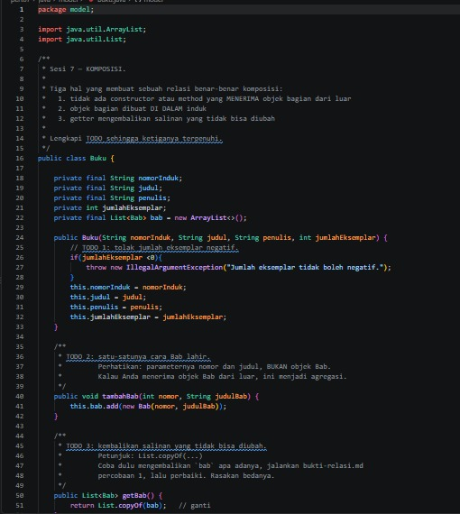

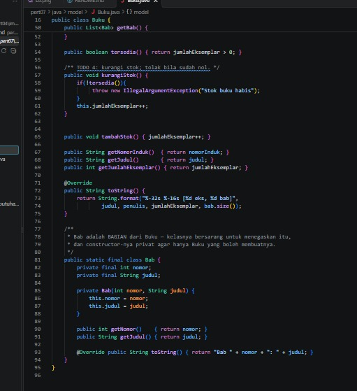


**Jurusan.Java**


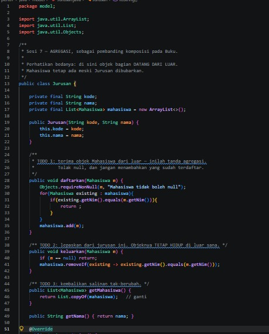

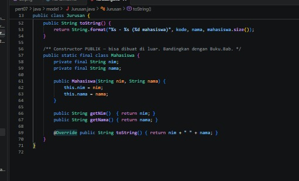

**Main.Java**


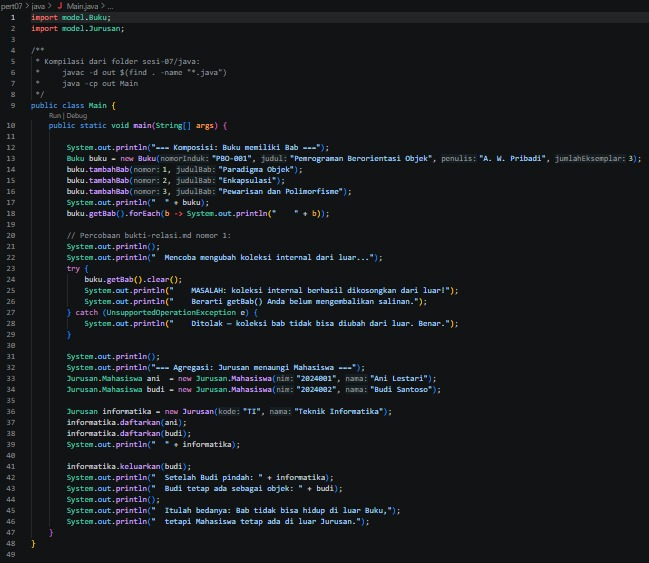


**Main.PHP**

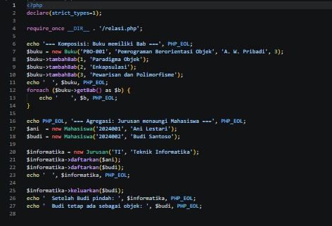


**Perpustakaan Service.Java**

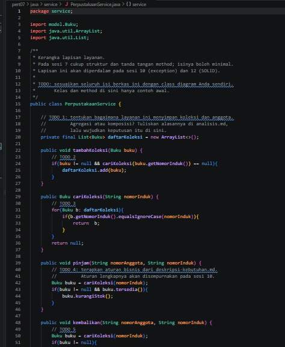

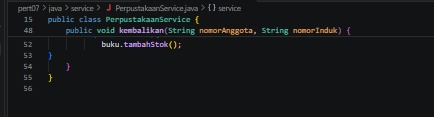

**Relasi.PHP**

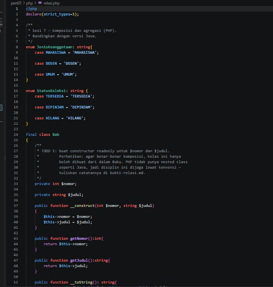

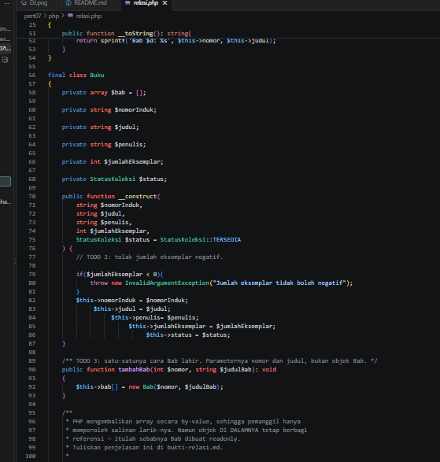

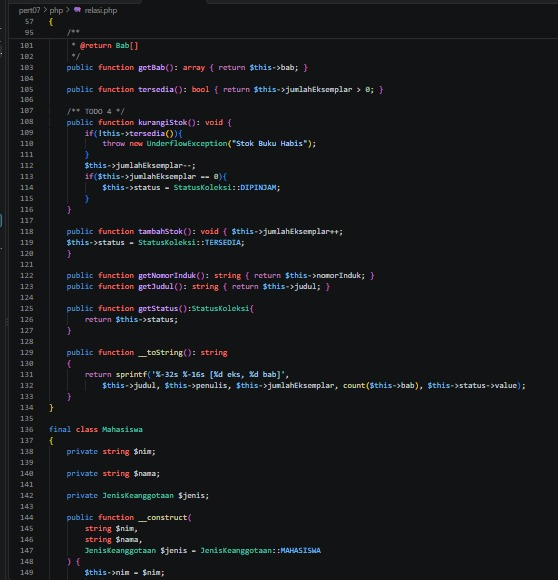

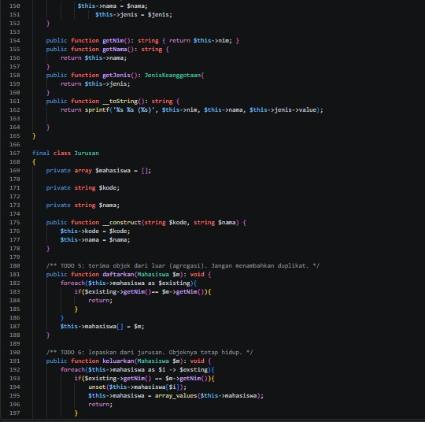

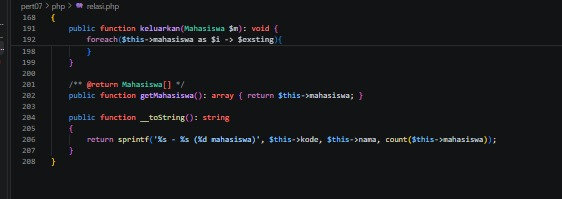

---


## 3. Struktur Proyek

```text
pert07/
├── java/
│   ├── model/
│   │   ├── Buku.java          (Komposisi dengan Bab)
│   │   └── Jurusan.java       (Agregasi dengan Mahasiswa)
│   ├── service/
│   │   └── PerpustakaanService.java (Manajemen Koleksi Buku)
│   └── Main.java              (Kelas Eksekusi/Driver Java)
└── php/
    ├── relasi.php             (Definisi Kelas Buku, Bab, Enum)
    └── Main.php               (Eksekusi Pengujian PHP)
