# Laporan Praktikum PBO A - Pert 10: "Exception Handling & Pemrograman Defensif"

**NAMA        : Adelita Daeli** 

**NPM         : 4525210049**

**Java**

1. PerpustakaanException.java
- After :
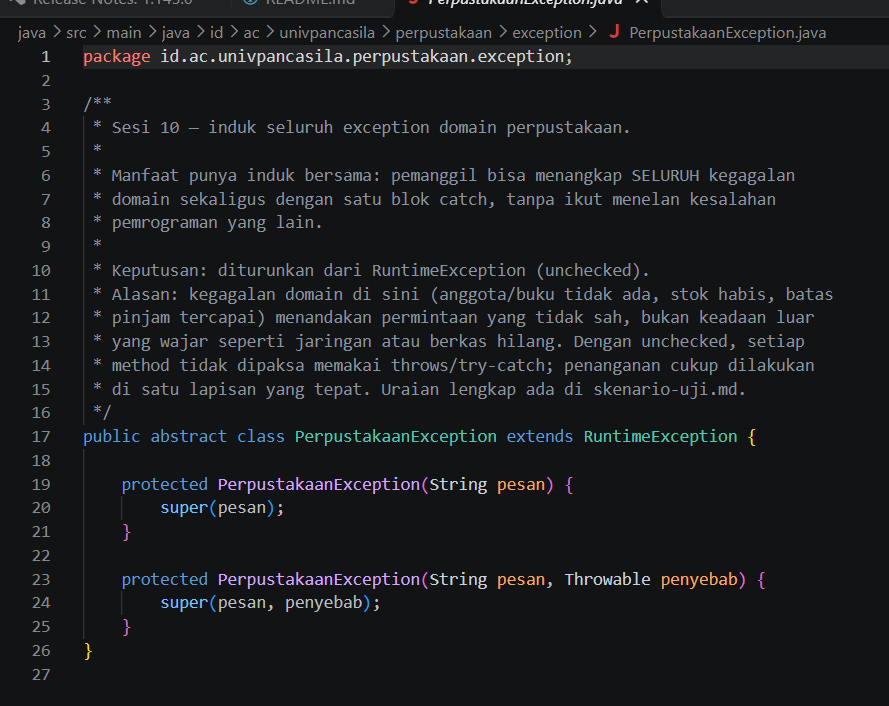

Class PerpustakaanException.java merupakan kelas induk bagi seluruh exception khusus yang digunakan dalam sistem perpustakaan. Kelas ini diturunkan dari RuntimeException, sehingga termasuk dalam kategori unchecked exception. Keberadaan kelas induk ini memungkinkan seluruh kesalahan yang berkaitan dengan proses dalam sistem perpustakaan ditangani melalui satu jenis exception yang sama.

2. AnggotaTidakDitemukanException.java

- After :
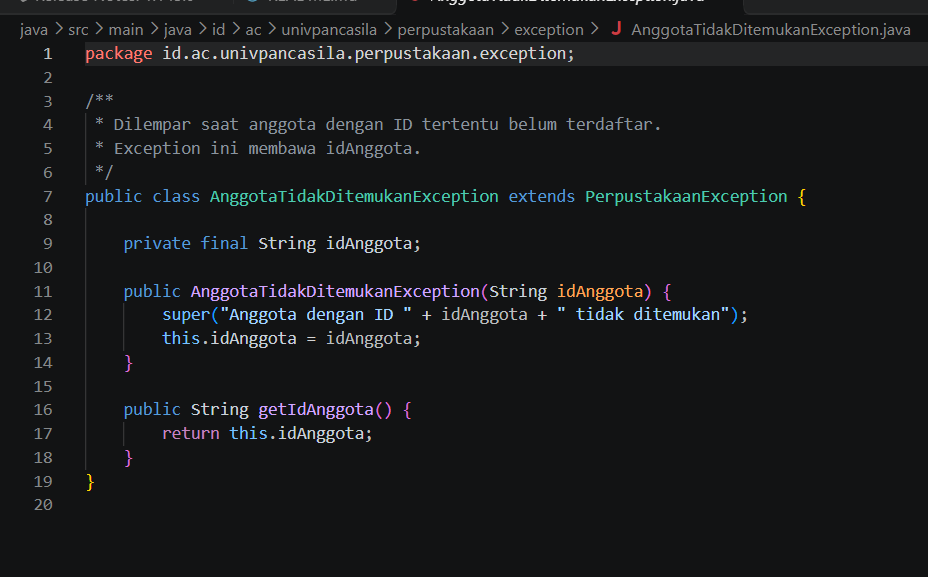

Class AnggotaTidakDitemukanException.java digunakan untuk menangani kondisi ketika anggota dengan ID tertentu tidak ditemukan atau belum terdaftar dalam sistem. Kelas ini menyimpan ID anggota yang mengalami masalah serta menyediakan getter untuk mengakses ID tersebut. Dengan demikian, pesan kesalahan yang ditampilkan dapat memberikan informasi yang lebih jelas dan spesifik.

3. BukuTidakDitemukanException.java
- After :
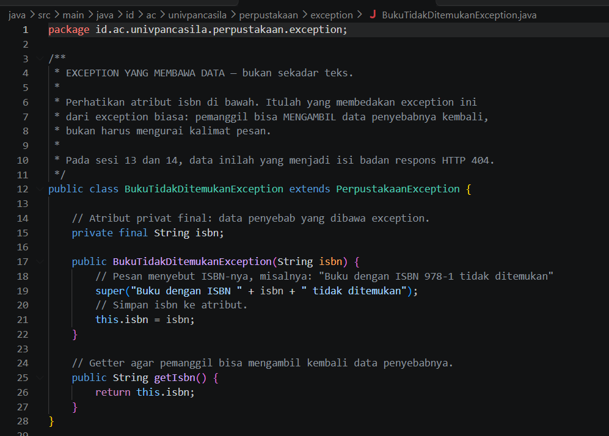

Class BukuTidakDitemukanException.java digunakan untuk menangani kondisi ketika ISBN buku yang dicari tidak ditemukan dalam katalog perpustakaan. Kelas ini menyimpan ISBN sebagai atribut serta menyediakan getter untuk mengakses data tersebut. Dengan adanya exception ini, sistem dapat memberikan informasi kesalahan yang lebih jelas ketika buku yang dicari tidak tersedia dalam data perpustakaan.

4. BukuSedangDipinjamException.java
- After 
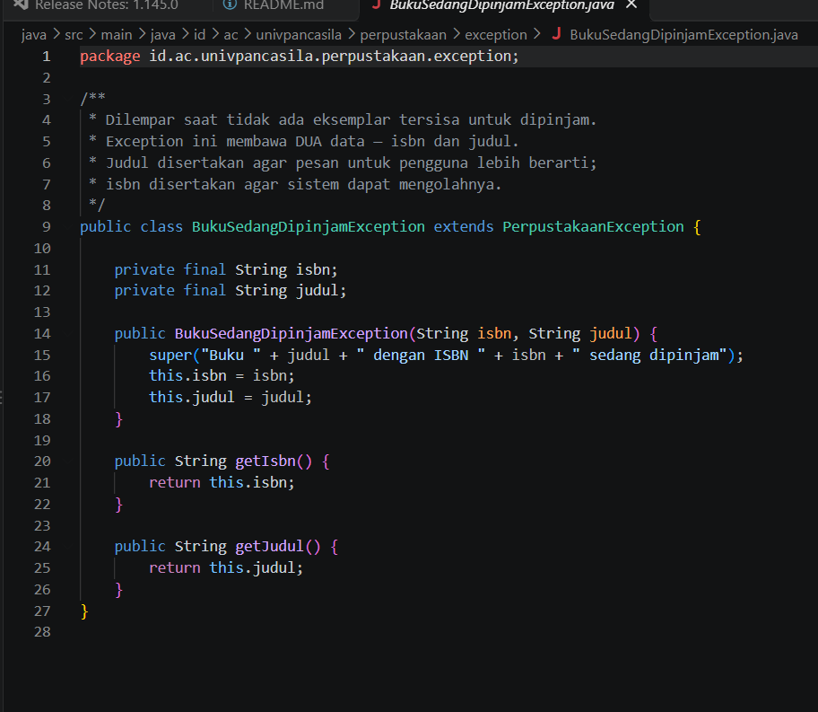

Class BukuSedangDipinjamException.java digunakan untuk menangani kondisi ketika stok buku telah habis atau tidak terdapat eksemplar yang tersedia untuk dipinjam. Kelas ini menyimpan informasi berupa ISBN dan judul buku, sehingga pesan kesalahan yang ditampilkan dapat memberikan keterangan yang lebih lengkap dan jelas kepada pengguna.

5. BatasPinjamTerlampauiException.java

- After :
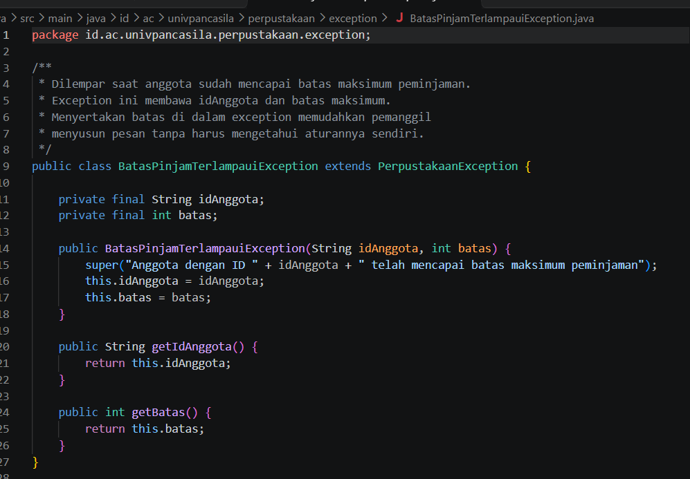

Class BatasPinjamTerlampauiException.java digunakan untuk menangani kondisi ketika anggota telah mencapai batas maksimal peminjaman buku. Kelas ini menyimpan informasi berupa ID anggota dan jumlah maksimal peminjaman, yaitu 3 buku. Selain itu, disediakan getter untuk mengakses informasi tersebut ketika exception ditangani.

6. Anggota.java
- After :
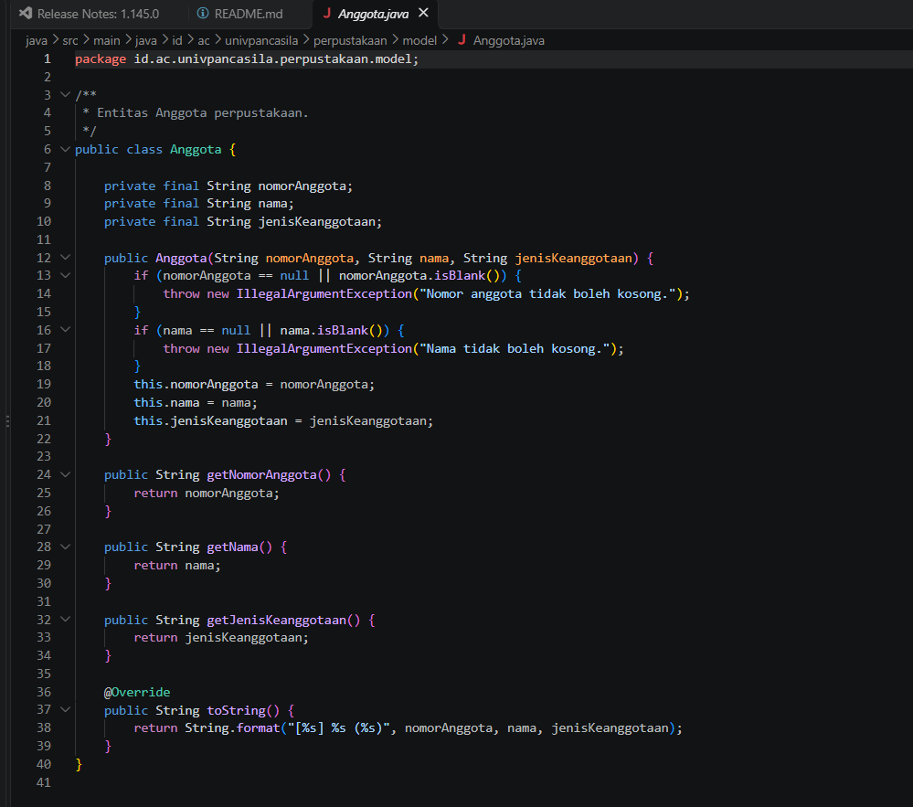

Class Anggota.java digunakan untuk merepresentasikan data anggota perpustakaan. Kelas ini memiliki beberapa atribut, yaitu nomor anggota, nama, dan jenis keanggotaan. Selain itu, terdapat validasi untuk memastikan nomor anggota dan nama tidak boleh kosong, getter untuk mengakses data, serta method toString() untuk menampilkan informasi anggota dalam bentuk teks.

7. Buku.java

- After :
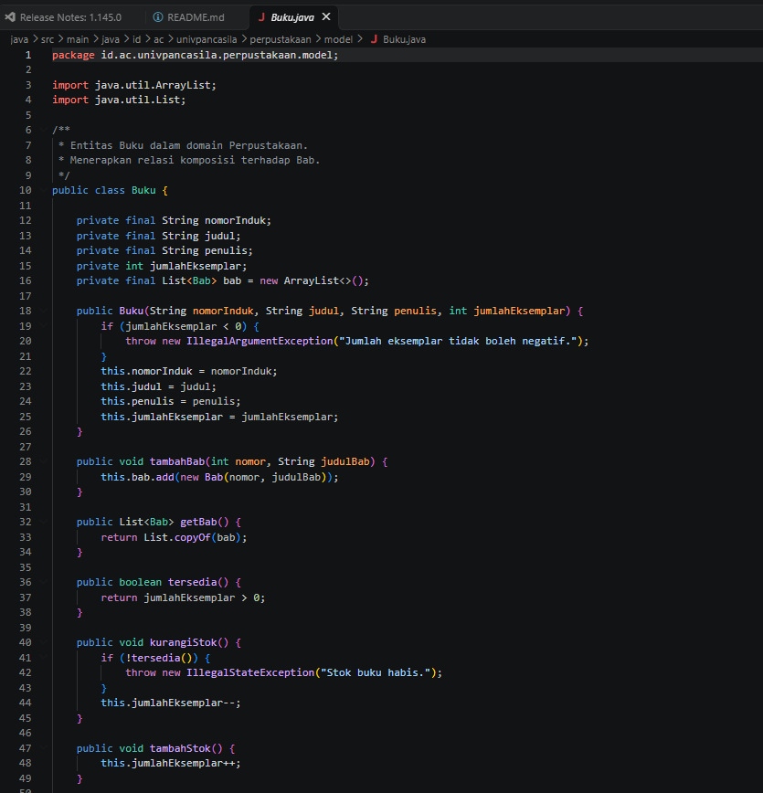
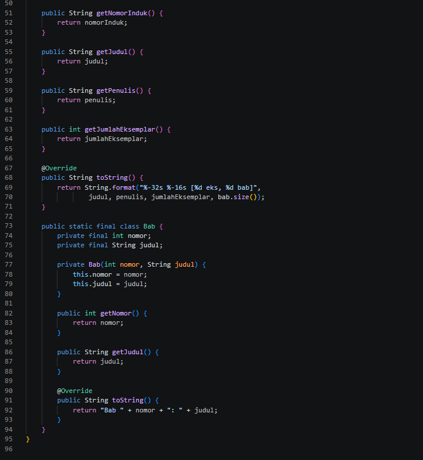

Class Buku.java digunakan untuk menyimpan data buku, seperti nomor induk, judul, penulis, dan jumlah eksemplar. Class ini memiliki fitur untuk menambahkan bab, melihat daftar bab, mengecek ketersediaan buku, serta menambah dan mengurangi stok. Selain itu, class ini menerapkan konsep komposisi melalui class Bab dan memiliki validasi agar jumlah stok tidak bernilai negatif.

8. Peminjaman.java

- After :
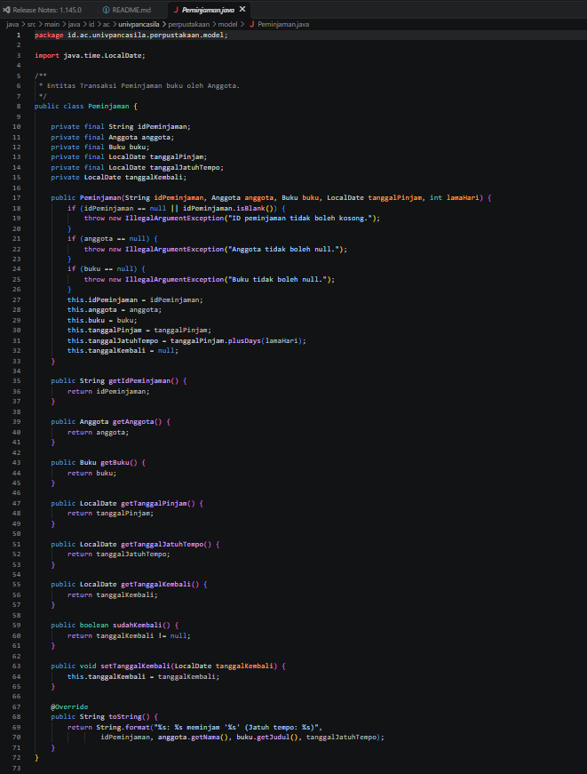

Class Peminjaman.java digunakan untuk merepresentasikan transaksi peminjaman buku oleh anggota. Class ini menyimpan ID peminjaman, data anggota, data buku, tanggal pinjam, tanggal jatuh tempo, dan tanggal kembali. Terdapat validasi data, getter, serta method untuk mengecek apakah buku sudah dikembalikan atau belum.

9. LibraryServiceKotor.java

- After :
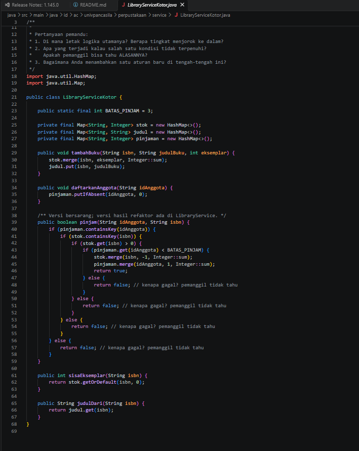

Class LibraryServiceKotor.java merupakan contoh kode awal yang digunakan sebagai bahan latihan refactoring. Pada kode ini, proses peminjaman buku masih menggunakan percabangan if bersarang, sehingga alur program menjadi cukup panjang dan sulit dipahami. Selain itu, ketika proses peminjaman gagal, method hanya mengembalikan nilai false tanpa memberikan penjelasan mengenai penyebab kegagalan tersebut.

10. LibraryService.java

- After :
  
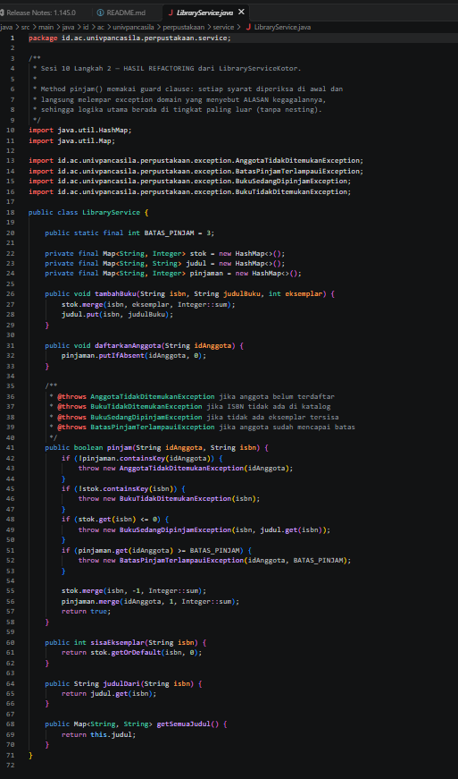

Class LibraryService.java merupakan hasil proses refactoring dari LibraryServiceKotor.java. Kelas ini bertanggung jawab untuk mengelola data buku, stok, anggota, serta jumlah peminjaman. Method pinjam() menerapkan konsep guard clause dengan melakukan pemeriksaan kondisi di awal proses dan melempar exception khusus apabila anggota tidak ditemukan, buku tidak tersedia, stok habis, atau batas maksimal peminjaman telah tercapai. Dengan penerapan ini, struktur kode menjadi lebih rapi, mudah dipahami, serta mampu memberikan informasi yang jelas mengenai penyebab kegagalan proses peminjaman.

11. PerpustakaanService.java

- After :
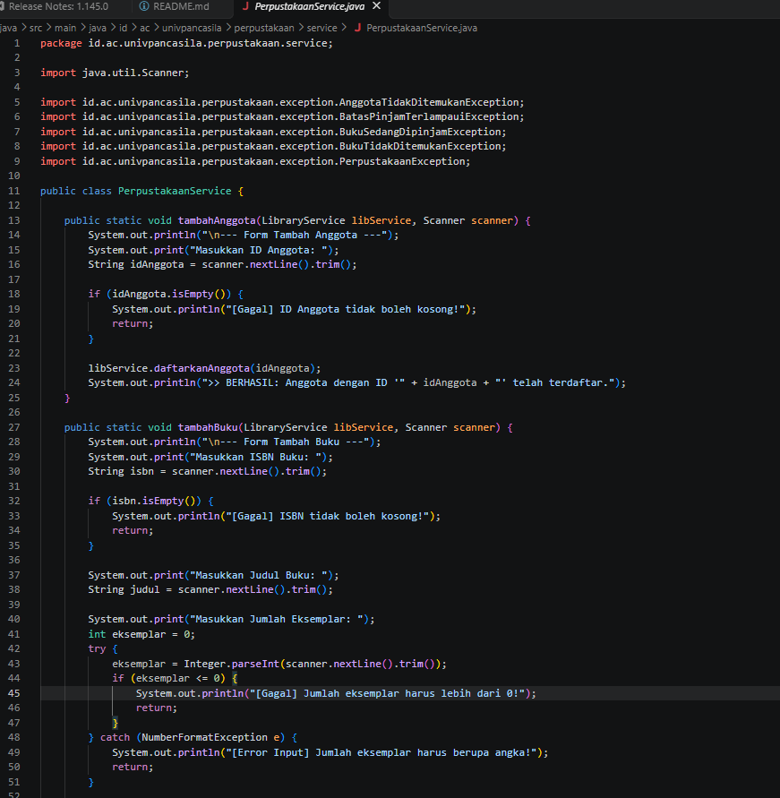
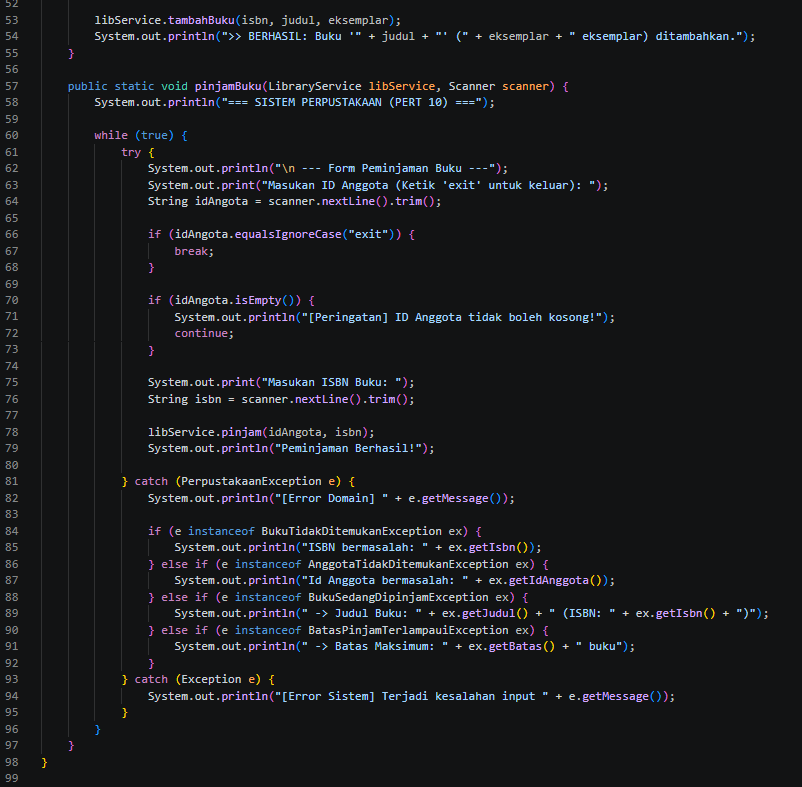

Class PerpustakaanService.java berisi proses interaksi antara pengguna dan sistem perpustakaan melalui menu tambah anggota, tambah buku, dan peminjaman buku. Class ini melakukan validasi input serta menangani exception menggunakan try-catch. Kesalahan dibedakan menjadi error domain dan error sistem agar pesan yang ditampilkan lebih mudah dipahami.

12. Main.java

- After :
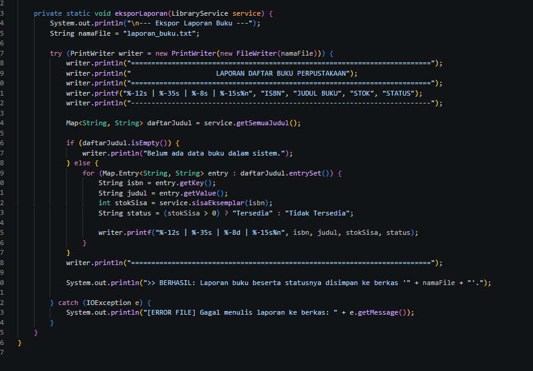
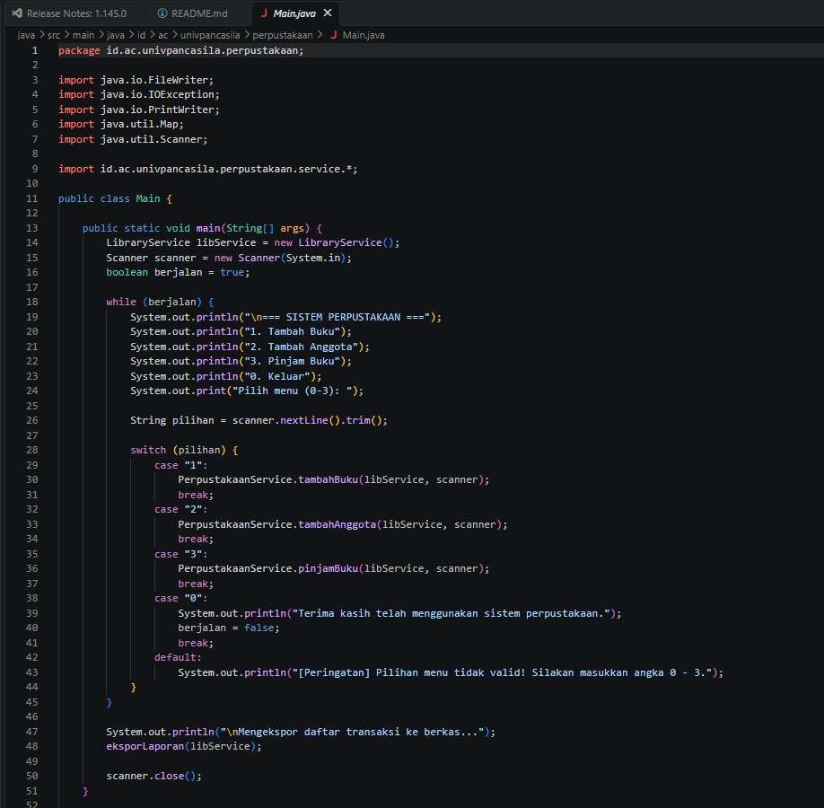

Class Main.java merupakan program utama untuk menjalankan sistem perpustakaan menggunakan Java. Program ini menampilkan menu untuk menambahkan buku, mendaftarkan anggota, dan melakukan peminjaman. Setelah program selesai, sistem akan mengekspor daftar buku beserta jumlah stok dan status ketersediaannya ke dalam file laporan_buku.txt. Proses penulisan file menggunakan try-with-resources dan menangani IOException jika terjadi kesalahan.

PHP
1. PerpustakaanException.php

- After :
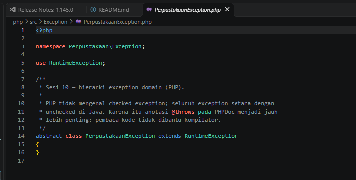

Class PerpustakaanException.php merupakan class induk untuk seluruh exception khusus pada sistem perpustakaan menggunakan PHP. Class ini diturunkan dari RuntimeException sehingga exception khusus lainnya dapat menggunakan jenis induk yang sama dan ditangani dalam satu blok catch.

2. AnggotaTidakDitemukanException.php

- After :
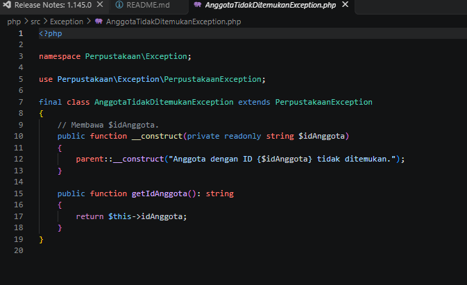

Class AnggotaTidakDitemukanException.php digunakan ketika ID anggota yang melakukan peminjaman tidak terdaftar. Class ini menyimpan ID anggota menggunakan property readonly dan menyediakan getter untuk mengambil informasi tersebut.

3. BukuTidakDitemukanException.php

- After :
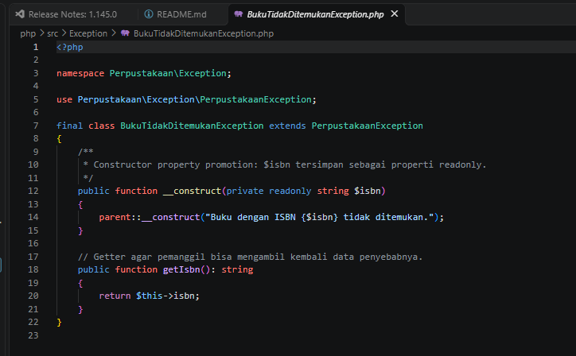

Class BukuTidakDitemukanException.php digunakan ketika ISBN buku tidak ditemukan di dalam katalog. Class ini menyimpan ISBN sebagai property readonly dan menyediakan getter agar data penyebab kesalahan dapat diambil kembali.

4. BukuSedangDipinjamException.php

- After :
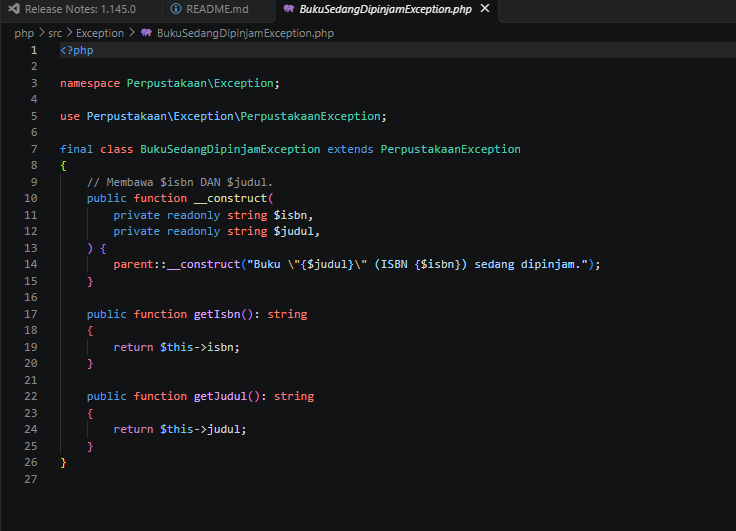

Class BukuSedangDipinjamException.php digunakan ketika stok buku sudah habis sehingga tidak bisa dipinjam. Class ini menyimpan ISBN dan judul buku menggunakan property readonly, kemudian menampilkan pesan kesalahan yang berisi informasi buku tersebut.

5. BatasPinjamTerlampauiException.php

- After :
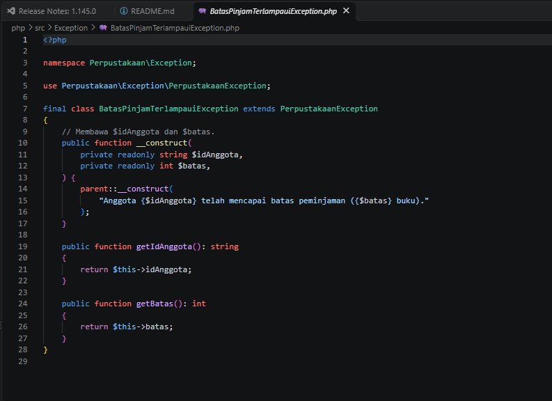

Class BatasPinjamTerlampauiException.php digunakan ketika anggota sudah mencapai batas maksimal peminjaman. Class ini menyimpan ID anggota dan batas peminjaman, serta menyediakan getter untuk mengambil kedua data tersebut.

6. Anggota.php

- After :
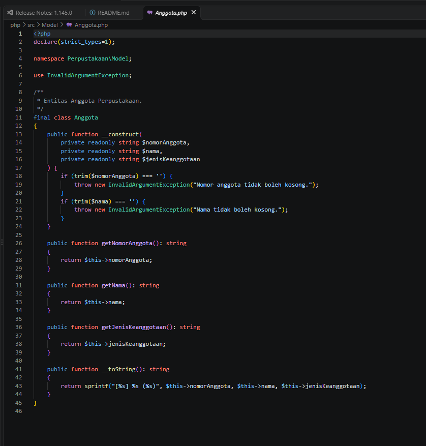

Class Anggota.php digunakan untuk merepresentasikan anggota perpustakaan menggunakan PHP. Class ini memiliki atribut nomor anggota, nama, dan jenis keanggotaan. Validasi dilakukan agar nomor anggota dan nama tidak boleh kosong. Class ini menggunakan constructor property promotion, property readonly, getter, dan method __toString().

7. Bab.php

- After :
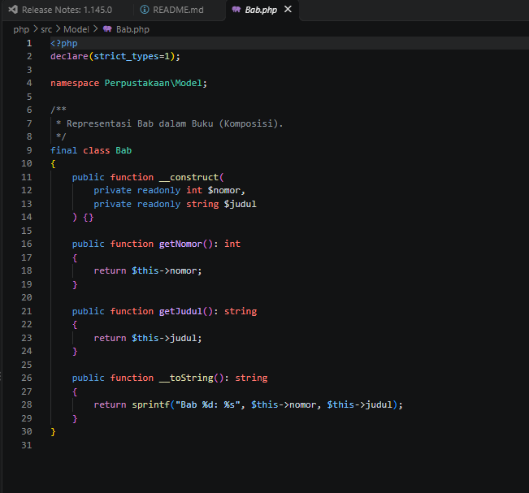

Class Bab.php digunakan untuk merepresentasikan bab yang terdapat di dalam sebuah buku. Class ini memiliki atribut nomor dan judul bab yang bersifat readonly, getter untuk mengambil data, serta method __toString() untuk menampilkan informasi bab. Class ini menjadi bagian dari penerapan konsep komposisi pada class Buku.

8. Buku.php

- After :
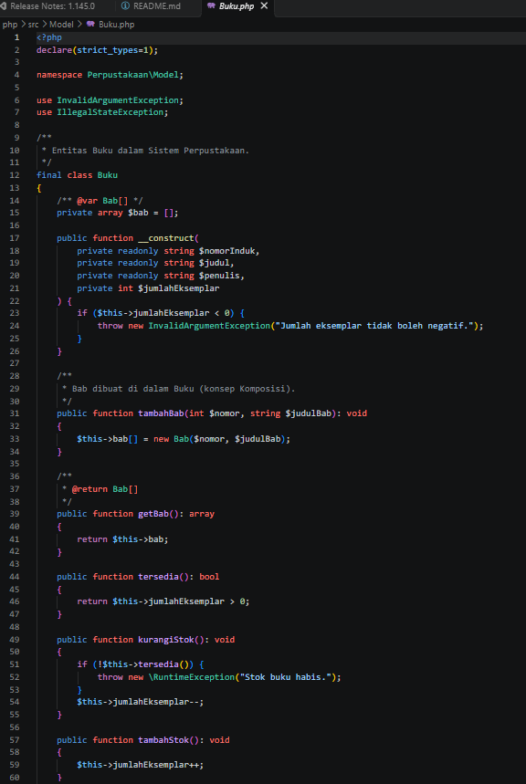
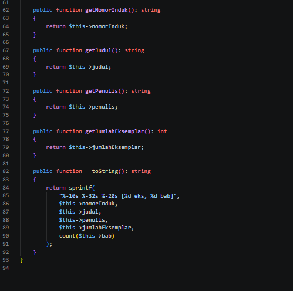

Class Buku.php digunakan untuk menyimpan data buku, seperti nomor induk, judul, penulis, dan jumlah eksemplar. Class ini memiliki fitur untuk menambahkan bab, melihat daftar bab, mengecek ketersediaan buku, serta menambah dan mengurangi stok. Terdapat validasi agar jumlah stok tidak negatif dan exception ketika stok buku habis.

9. Peminjaman.php

- After :
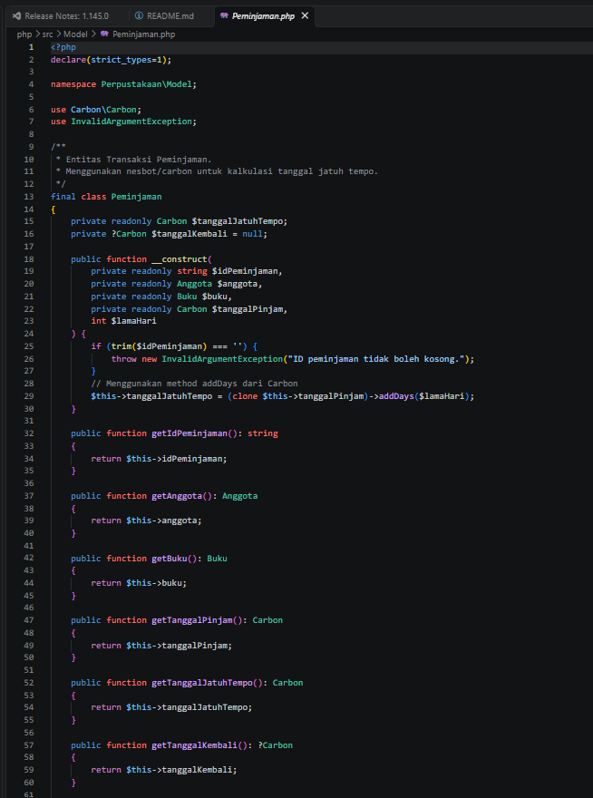
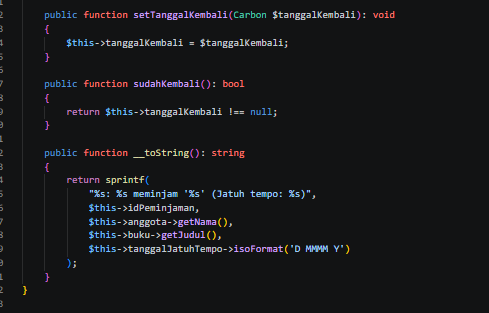

Class Peminjaman.php digunakan untuk menyimpan data transaksi peminjaman buku. Class ini memiliki atribut ID peminjaman, anggota, buku, tanggal pinjam, tanggal jatuh tempo, dan tanggal kembali. Class ini menggunakan library Carbon untuk menghitung tanggal jatuh tempo berdasarkan lama hari peminjaman. Selain itu, terdapat getter dan method untuk mengecek status pengembalian buku.

10. LibraryServiceKotor.php

- After :
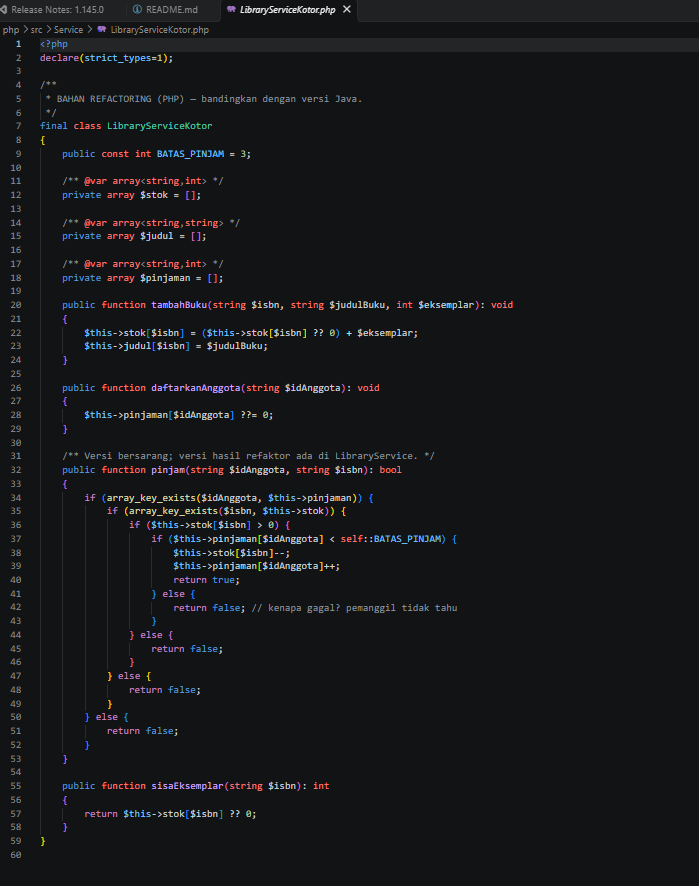

Class LibraryServiceKotor.php merupakan contoh kode awal sebelum dilakukan refactoring. Method pinjam() masih menggunakan percabangan if bersarang untuk memeriksa anggota, buku, stok, dan batas peminjaman. Jika salah satu kondisi tidak terpenuhi, method hanya mengembalikan false tanpa memberikan alasan kegagalan.

11. LibraryService.php

- After :
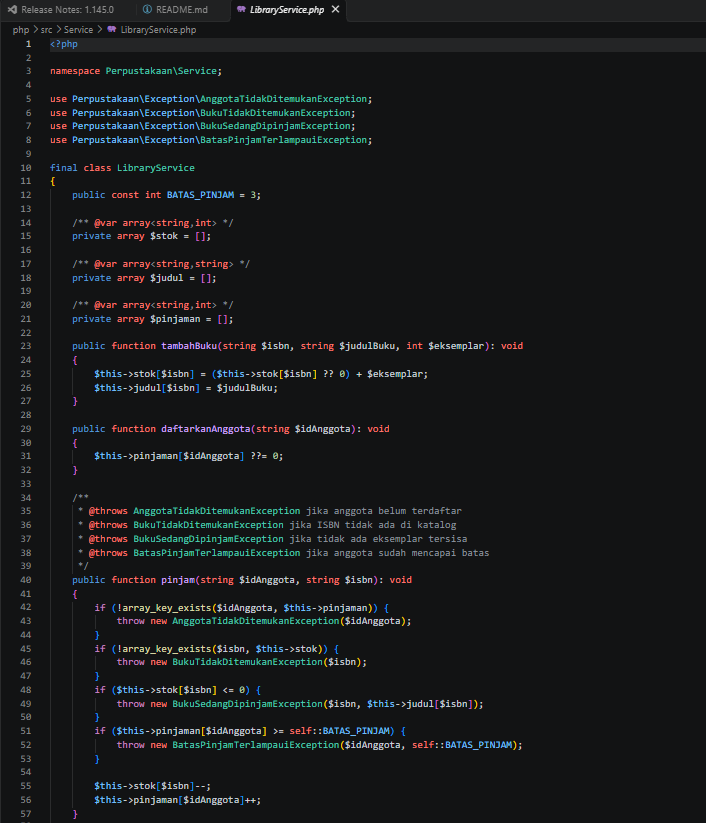
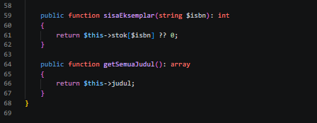

Class LibraryService.php merupakan hasil refactoring dengan menggunakan konsep guard clause. Class ini mengelola data buku, stok, anggota, dan jumlah peminjaman. Method pinjam() melakukan pemeriksaan kondisi di awal dan melempar exception khusus sesuai penyebab kegagalan. Batas peminjaman ditentukan maksimal 3 buku untuk setiap anggota.

12. Main.php

- After :
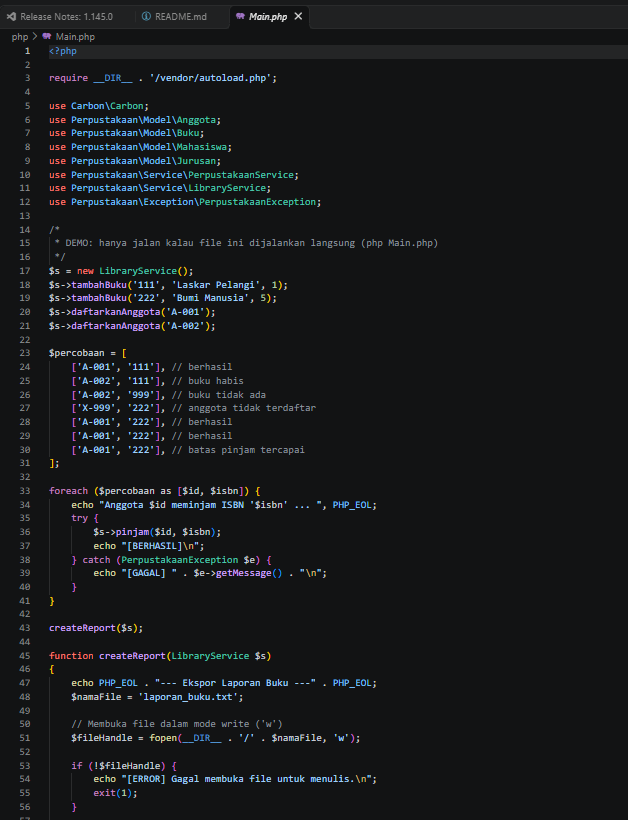
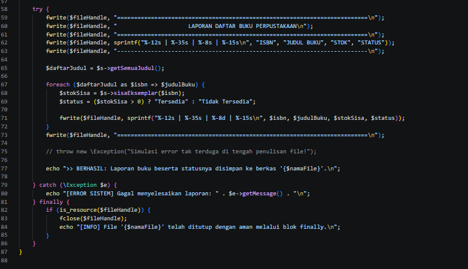

File Main.php merupakan program utama untuk menjalankan dan menguji sistem perpustakaan menggunakan PHP. Program ini membuat data buku dan anggota, kemudian melakukan beberapa percobaan peminjaman untuk menguji kondisi berhasil maupun gagal. Exception ditangani menggunakan try-catch agar penyebab kegagalan dapat ditampilkan.

Selain itu, file ini memiliki fungsi createReport() untuk mengekspor daftar buku, jumlah stok, dan status ketersediaan ke dalam file laporan_buku.txt. Proses penulisan file menggunakan try-catch-finally, sehingga file tetap ditutup dengan aman melalui blok finally.

Kesimpulan
Pada Pertemuan 10, praktikum membahas Exception Handling dan Pemrograman Defensif menggunakan Java dan PHP. Materi yang diterapkan meliputi pembuatan custom exception, penggunaan try-catch, validasi input, guard clause, serta penanganan kesalahan saat proses penulisan file. Selain itu, dilakukan refactoring dari kode dengan percabangan bersarang menjadi kode yang lebih rapi dan mudah dipahami.
