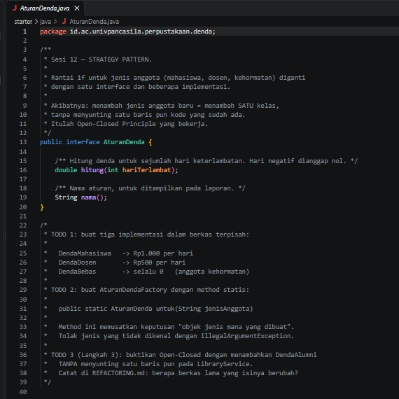
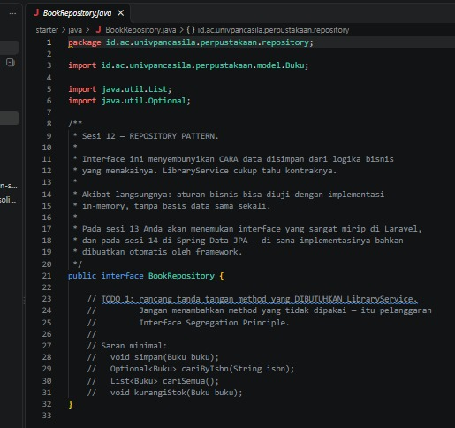
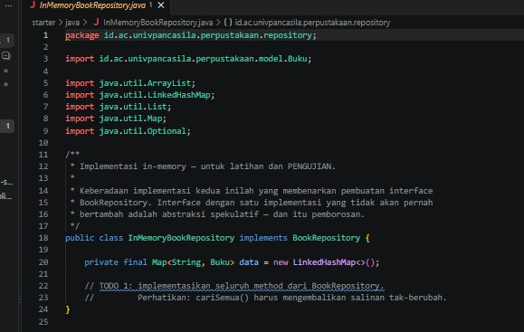
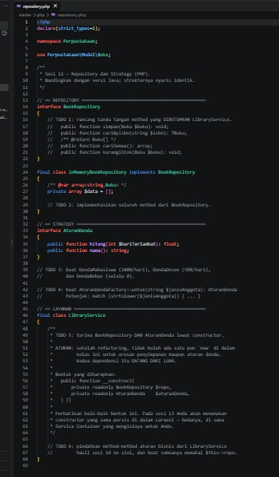

# Praktikum 12: Refactoring dengan SOLID dan Repository Pattern

**Nama:** Adelita Daeli  
**NPM:** 4525210049  
**Kelas:** A  
**Mata Kuliah:** Praktikum Pemrograman Berorientasi Objek (PBO)  

---

## Deskripsi Proyek
Proyek ini berfokus pada penerapan prinsip-prinsip **SOLID** dan **Repository Pattern** untuk melakukan *refactoring* pada sistem manajemen perpustakaan (`id.ac.univpancasila.perpustakaan`)[cite: 1]. Tujuannya adalah memisahkan logika bisnis dari mekanisme penyimpanan data, mengurangi ketergantungan antar kelas (*loose coupling*), serta mempermudah pengujian unit (*unit testing*)[cite: 1].

---

## Dokumentasi

**Before**

**Java**







**PHP**


```


## Struktur Proyek

Struktur direktori utama pada proyek ini mencakup implementasi di lingkungan Java dan PHP[cite: 1, 2]:

```text
Pert12/
├── Modul-Praktikum-12-refactoring-dengan-solid-dan-repository-pattern.docx
├── README.md
└── starter/
    ├── CATATAN.md
    ├── composer.json
    ├── composer.lock
    ├── REFACTORING-template.md
    ├── REFACTORING.md
    ├── tests/
    ├── vendor/
    ├── java/                                      # Implementasi Java (Maven)
    │   ├── pom.xml
    │   ├── laporan_buku.txt
    │   └── src/
    │       ├── main/java/id/ac/univpancasila/perpustakaan/
    │       │   ├── Main.java
    │       │   ├── denda/                         # Aturan & Factory perhitungan denda
    │       │   ├── exception/                     # Custom exception perpustakaan
    │       │   ├── model/                         # Entitas domain (Anggota, Buku, Jurusan)
    │       │   ├── repository/                    # Abstraksi & implementasi penyimpanan data
    │       │   ├── service/                       # Logika bisnis (LibraryService, dll.)
    │       │   └── util/                          # Utilitas pemformatan (Format.java)
    │       └── test/java/id/ac/univpancasila/perpustakaan/
    │           ├── repository/RepositoryTest.java
    │           └── service/LibraryServiceTest.java
    └── php/                                       # Implementasi PHP (Composer & PHPUnit)
        ├── composer.json
        ├── main.php
        ├── laporan_buku.txt
        ├── src/
        │   ├── Denda/
        │   ├── Exception/
        │   ├── Model/
        │   ├── Repository/
        │   ├── Service/
        │   └── Util/
        └── tests/
            ├── Repository/KoleksiBukuTest.php
            └── Service/LibraryServiceTest.php
```[cite: 1, 2]

---

## Konsep yang Diterapkan

### 1. Prinsip SOLID
* **Single Responsibility Principle (SRP):** Memisahkan tanggung jawab antara representasi data (`model`), akses penyimpanan (`repository`), aturan perhitungan denda (`denda`), dan alur layanan (`service`)[cite: 1].
* **Open/Closed Principle (OCP):** Menggunakan antarmuka `AturanDenda` dan `AturanDendaFactory` (`DendaMahasiswa`, `DendaDosen`, `DendaAlumni`, `DendaBebas`) sehingga penambahan jenis aturan denda baru tidak perlu mengubah kode lama[cite: 1].
* **Liskov Substitution Principle (LSP):** Setiap implementasi subkelas denda maupun repositori dapat menggantikan tipe induk/antarmukanya tanpa merusak perilaku program[cite: 1].
* **Interface Segregation Principle (ISP):** Memecah kontrak antarmuka agar spesifik sesuai kebutuhan, seperti pemisahan `Repository` generik dan `BookRepository`[cite: 1].
* **Dependency Inversion Principle (DIP):** Kelas layanan tingkat tinggi (`LibraryService` / `PerpustakaanService`) bergantung pada abstraksi (`BookRepository`), bukan langsung pada detail implementasi (`InMemoryBookRepository`), dibandingkan versi sebelum *refactoring* (`LibraryServiceKotor`)[cite: 1].

### 2. Repository Pattern
* **`Repository` & `BookRepository`:** Mendefinisikan kontrak operasi CRUD dan pencarian data buku[cite: 1].
* **`InMemoryBookRepository` / `KoleksiBuku`:** Mengimplementasikan penyimpanan data di memori tanpa membocorkan struktur penyimpanan internal ke lapisan `Service`[cite: 1].

## Cara Menjalankan Program & Pengujian

### Java (Maven)
Masuk ke direktori `starter/java`:
```bash
# Menjalankan aplikasi utama
mvn compile exec:java -Dexec.mainClass="id.ac.univpancasila.perpustakaan.Main"

# Menjalankan unit test
mvn test
```[cite: 1]

### PHP (Composer & PHPUnit)
Masuk ke direktori `starter/php`:
```bash
# Menjalankan aplikasi utama
php main.php

# Menjalankan unit test
./vendor/bin/phpunit

---


