### LAPORAN PRAKTIKUM PBO PERT 2
**NAMA : ADELITA DAELI**

**NPM  : 4525210049**

**Enkapsulasi dan Penjagaan Invariant**
    Proyek ini merupakan latihan pemrograman berorientasi objek (OOP) yang berfokus pada konsep enkapsulasi dan penjagaan invariant (aturan kevalidan data objek) menggunakan dua bahasa pemrograman, yaitu Java dan PHP.

📌 **Deskripsi Masalah**
Sistem akademik mencatat data mahasiswa dengan ketentuan sebagai berikut:
1. Atribut Utama: NIM, Nama, dan tiga komponen nilai (Tugas, UTS, dan UAS).
2. Immutable NIM: NIM tidak boleh berubah setelah mahasiswa terdaftar (menggunakan final di Java dan readonly di PHP).
3. Validasi Invariant Nilai: Setiap komponen nilai wajib berada di dalam rentang inklusif 0 sampai 100.
4.  Perhitungan Nilai Akhir: Dihitung menggunakan bobot tetap:
   * Tugas: 30% (BOBOT_TUGAS = 0.30)
   * UTS: 30% (BOBOT_UTS = 0.30)
   * UAS: 40% (BOBOT_UAS = 0.40)
5. Konversi Huruf Mutu:
   * $\ge 80 \rightarrow$ "A"
   * $\ge 70 \rightarrow$ "B"
   * $\ge 60 \rightarrow$ "C"
   * $\ge 50 \rightarrow$ "D"
   * Lainnya $\rightarrow$ "E"
     
📂 **Struktur Berkas**
 * analisis.md — Daftar spesifikasi invariant dan aturan validasi objek.
 * Mahasiswa.java — Implementasi kelas dalam bahasa Java.
 * Mahasiswa.php — Implementasi kelas dalam bahasa PHP 8+.
   

**Output**

**BEFORE**
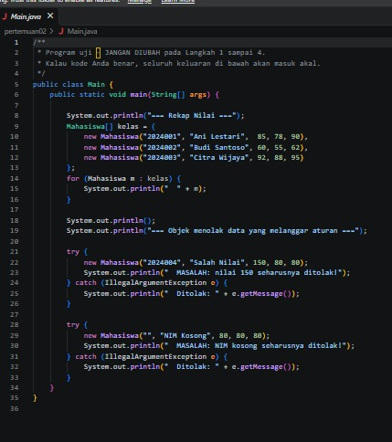

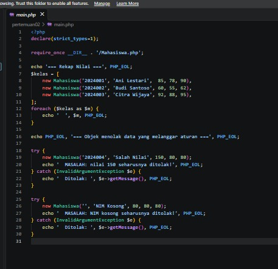

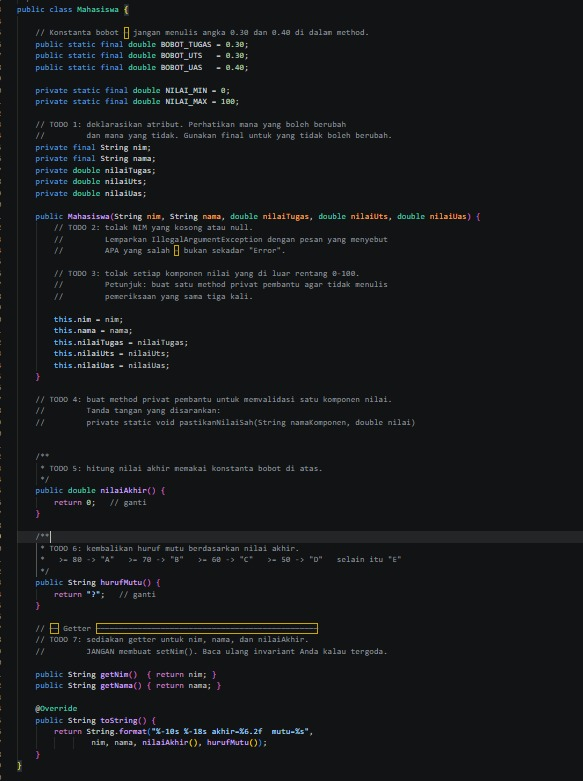

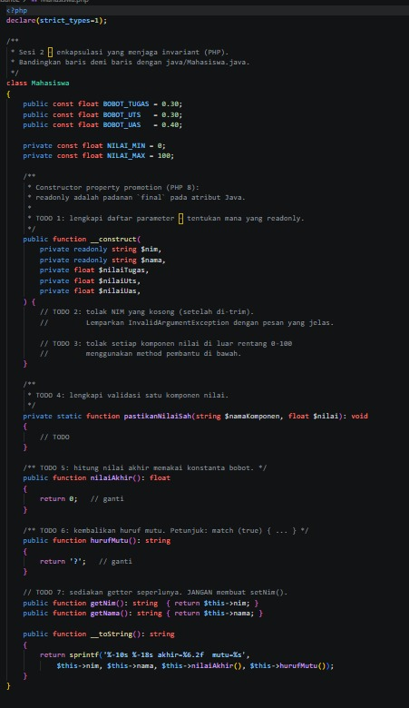


**AFTER**
**Mahasiswa.Java**

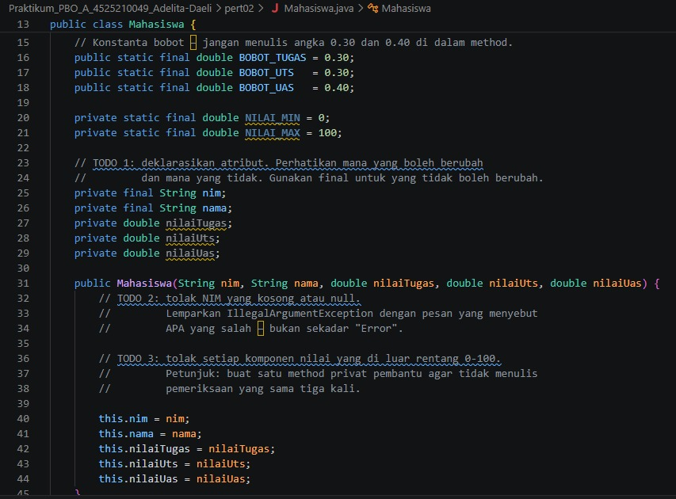

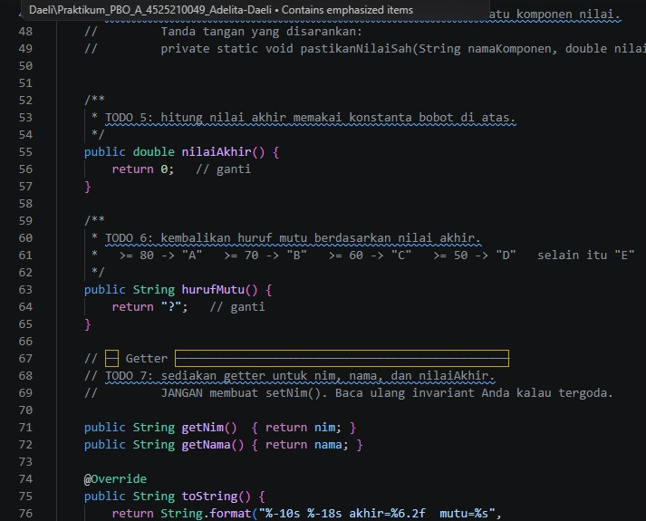

**Mahasiswa.PHP**

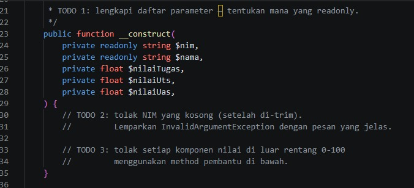

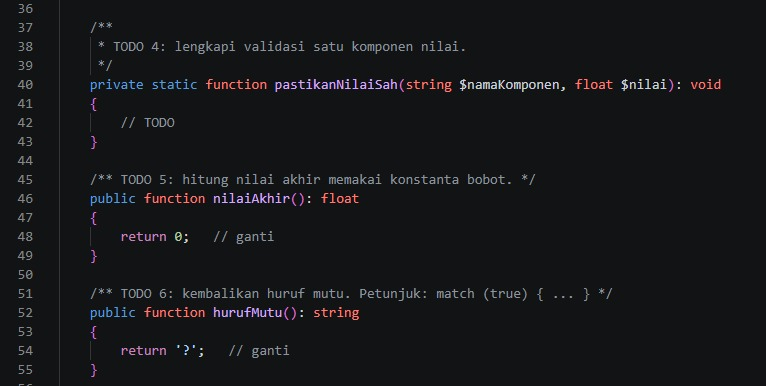

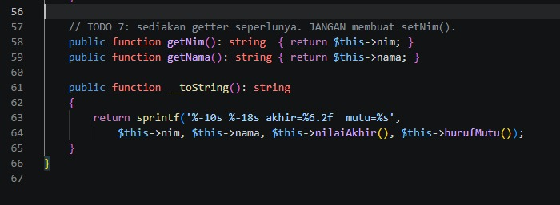

**Main.Java**

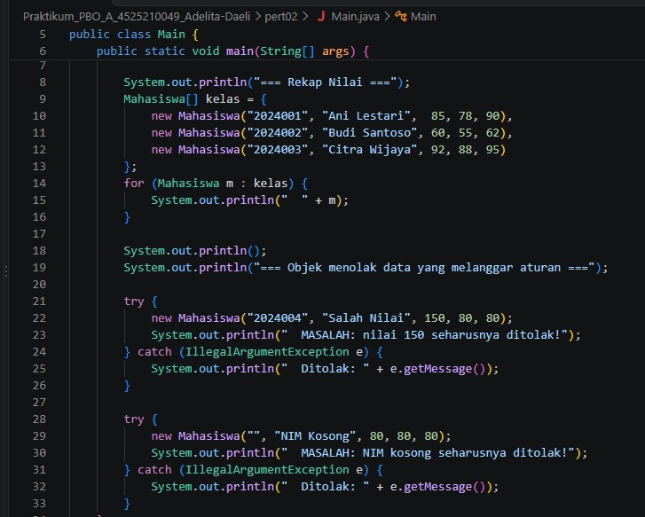

**Main.PHP**

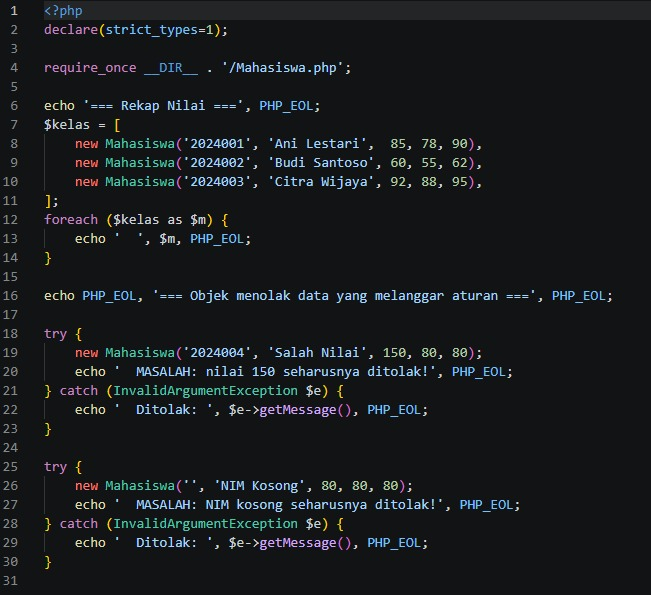

 
## 🚀 Cara Menjalankan Program

### 1. Java (`Main.java` & `RekeningBank.java`)
Pastikan Anda sudah menginstal Java Development Kit (JDK 8 atau yang lebih baru).

* **Kompilasi program:**
  ```bash
  javac Main.java RekeningBank.java

🛡️ Penjagaan Invariant (Invariant Guard)Setiap upaya untuk memasukkan data yang melanggar aturan (seperti NIM kosong atau nilai negatif/di atas 100) akan langsung digagalkan pada tahap konstruksi objek dengan melempar IllegalArgumentException (Java) atau InvalidArgumentException (PHP). Hal ini menjamin bahwa objek Mahasiswa tidak pernah berada dalam kondisi tidak sah (invalid state).
